# Roofing Robot: Complete System and Error Handling Guide

All diagrams are in the `../diagrams/` folder next to this file. The `.mmd` files are the editable sources, and the `.png` files are the renders shown below.

## Table of contents

- [1. What the robot is doing](#1-what-the-robot-is-doing)
- [2. How the parts talk to each other](#2-how-the-parts-talk-to-each-other)
  - [The live camera](#the-live-camera)
- [3. The subsystems in detail](#3-the-subsystems-in-detail)
  - [At a glance](#at-a-glance)
  - [3.1 Supervisor](#31-supervisor)
  - [3.2 Locomotion](#32-locomotion)
  - [3.3 Plate](#33-plate)
  - [3.4 Screw](#34-screw)
  - [3.5 Fastening](#35-fastening)
  - [3.6 Live camera and light](#36-live-camera-and-light)
  - [3.7 Operator screen, Start button, and E-stop](#37-operator-screen-start-button-and-e-stop)
  - [3.8 Stack light](#38-stack-light)
- [4. How the subsystems work together](#4-how-the-subsystems-work-together)
  - [4.1 Who talks to whom](#41-who-talks-to-whom)
  - [4.2 Message reference](#42-message-reference)
  - [4.3 The rules that tie it together](#43-the-rules-that-tie-it-together)
  - [4.4 One spot, step by step](#44-one-spot-step-by-step)
  - [4.5 End of a row](#45-end-of-a-row)
  - [4.6 When something goes wrong](#46-when-something-goes-wrong)
  - [4.7 Time limits](#47-time-limits)
- [5. A normal run (no errors)](#5-a-normal-run-no-errors)
  - [How to read the Supervisor state chart](#how-to-read-the-supervisor-state-chart)
- [6. The error rule](#6-the-error-rule)
- [7. Summary of all errors](#7-summary-of-all-errors)
- [8. Each error](#8-each-error)
  - [E1: Plate did not arrive (jam)](#e1-plate-did-not-arrive-jam)
  - [E2: Plate placement rejected](#e2-plate-placement-rejected)
  - [E3: Out of plates](#e3-out-of-plates)
  - [E4: Screw missing or not in the right spot](#e4-screw-missing-or-not-in-the-right-spot)
  - [E5: Out of screws](#e5-out-of-screws)
  - [E6: Torque not reached](#e6-torque-not-reached)
  - [E7: Photo rejected](#e7-photo-rejected)
  - [E8: Locomotion fault](#e8-locomotion-fault)
  - [E9: Live camera feed lost](#e9-live-camera-feed-lost)
  - [E10: Emergency stop](#e10-emergency-stop)
- [9. Decisions made](#9-decisions-made)
- [10. Still open](#10-still-open)

---

## 1. What the robot is doing

The robot covers the roof like mowing a lawn. It starts at the **bottom left** of the roof and drives in a **straight line along a row**, stopping at each **spot** to fasten. At the end of the row it **turns onto the next crest** and drives back down it in the opposite direction, and repeats until all rows are done. The rows, the number of spots in each, and the distances between them come from a **route map** programmed into the robot.

At each spot it completes three jobs, in order, **before it moves on**:

| Step | Subsystem | What happens | How it is checked |
|---|---|---|---|
| 0 | Locomotion (straight) | Drive along the row to the next spot | Crest sensors confirm it is on the crest; position confirms it is at the right spot |
| 1 | Plate | Feed a plate toward fastening position, push it into place, then release it | **Live camera** confirms the plate arrived; live camera + tripwire approve the placement |
| 2 | Screw | Load a screw into fastening position | **Live camera sees the plate and screw together** and confirms both are in the right spot, before fastening starts |
| 3 | Fastening | Drill the screw in | Torque reaches the right value within 10 seconds, then the live camera takes a photo that must be accepted |
| 4 | Locomotion (turn), **only at the end of a row** | (First, if the route map says so, drive on past the last screw to the level where the next strip's first screw is.) Turn 90 right, drive forward until the front sensor has counted the planned number of crests and the encoder agrees with the planned row gap, turn 90 right again (odd rows). On even rows both turns are left. | Front sensor + encoder |

After step 3 the Supervisor checks the row:
- **More spots in this row (per the route map):** go back to step 0 and drive straight to the next spot.
- **End of the row, more rows left:** do step 4, then step 0 on the next row, now travelling the opposite way.
- **Last spot of the last row:** the run is complete.

## 2. How the parts talk to each other

One **Supervisor** (the master state machine) sits in the middle. Subsystems never talk to each other. They only:

- receive `CMD_START` from the Supervisor,
- reply `DONE`, `FAULT` (with a code), or `NEED_REFILL`.

The Supervisor holds the programmed **route map**, and tracks the current row and spot, retries, and a fault log. It also talks to the operator screen: it sends alerts and fault history, and it receives `RESOLVED` and `SKIP_SPOT`.

### The live camera

A single **live camera** watches the fastening area and streams continuously. The plate and the screw end up in the **same area**, so one camera can see both before the robot fastens. It does four jobs:

1. **Confirms the plate arrived.** A jam is caught here, **before** the robot tries to place a plate that is not there.
2. **Approves the placement.** With the tripwire, it approves the plate's placement.
3. **Checks the plate and screw together.** After the screw is loaded, the camera sees both and confirms both are in the right spot **before fastening starts**. This also catches a plate that moved after it was placed, or a screw that is not lined up with it.
4. **Verifies the result and shows the operator.** The Fastening subsystem uses it to take the photo of the finished screw. The same feed is shown on the operator screen, so when the robot stops and alerts, the operator can see the problem without walking up to the robot first.

**Enclosure and light.** The camera sits in an **enclosed space** with its own **light**, so glare and changing sunlight do not affect it and the picture stays the same from spot to spot.

Because every check above depends on it, the Supervisor also watches that the feed is alive and usable. If the feed drops, the lens is blocked, or the image goes too dark (for example the light fails), the robot stops (see E9).

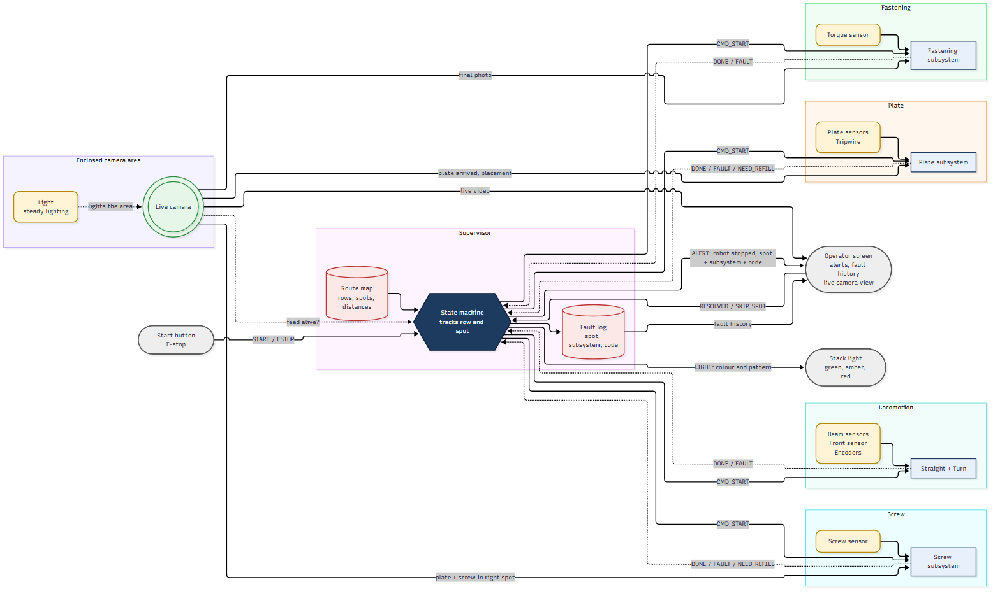

## 3. The subsystems in detail

Each subsystem is a self-contained unit that does **one job** when the Supervisor tells it to. It checks its own work with its sensors and the live camera, then reports back with `DONE`, `FAULT` (with a code), or `NEED_REFILL`. It never starts on its own and never talks to another subsystem. Before it reports, it returns to a **safe-to-move state** (wheels stopped, plate released, drill retracted).

### At a glance

| Subsystem | Its job | What it uses | What it can report |
|---|---|---|---|
| **Supervisor** | Runs the whole sequence, holds the route map, handles faults and the operator | Route map, fault log, messages from everything | Sends commands and alerts |
| **Locomotion** | Drive along a row, turn at the end of a row | Crest sensors, front sensor, encoders | `DONE`, `OFF_CREST`, `CANNOT_REACH_SPOT`, `OVERSHOT_SPOT`, `NOT_ALIGNED`, `TURN_FAILED` |
| **Plate** | Put a plate in place | Plate sensors (supply), tripwire, live camera | `DONE`, `NEED_REFILL`, `PLATE_NOT_ARRIVED`, `PLACEMENT_REJECTED` |
| **Screw** | Load a screw next to the plate | Screw sensor (supply), live camera | `DONE`, `NEED_REFILL`, `SCREW_NOT_IN_POSITION` |
| **Fastening** | Drive the screw in and photograph it | Torque sensor, live camera | `DONE`, `TORQUE_TIMEOUT`, `PHOTO_REJECTED` |
| **Live camera + light** | See the plate and screw, take the photo, stream to the operator | Enclosure, light | Video, and "feed alive" to the Supervisor |
| **Operator screen + buttons** | Start the run, show alerts, take the operator's decisions | Start button, E-stop, screen | `START`, `RESOLVED`, `SKIP_SPOT`, `ESTOP` |
| **Stack light** | Show the robot's status at a glance, even when the operator is not looking at the screen | Coloured lamps on the robot | Nothing (output only, set by the Supervisor) |

The sensor roles above are my reading of your original flows. Please confirm them (see the open items at the end).

### 3.1 Supervisor

The Supervisor is the brain. It is the only part that knows the whole plan.

**It holds:**
- the **route map** (rows, spots per row, distances, turn directions),
- where the robot is now (row and spot),
- the retry count for the step in progress,
- the **fault log** (spot, subsystem, fault code, time, operator action),
- its own **state machine** (section 5).

**It does:**
- sends `CMD_START` to **one subsystem at a time** and waits for the reply,
- on `DONE`, moves to the next step,
- on `FAULT`, retries the same step up to 2 times, then stops and alerts the operator,
- on `NEED_REFILL`, stops at once and alerts,
- checks that the camera feed is alive,
- handles the operator's `RESOLVED` and `SKIP_SPOT`, and the E-stop.

### 3.2 Locomotion

Locomotion moves the robot. It has two jobs: driving straight along a row, and turning onto the next row. The route map tells it how far to go and which way to turn.

**Drive straight to the next spot.** (A negative distance means reverse. While driving, Locomotion steers to keep the screw line over the crest centre, using the crest sensor array directly.) It checks it is on the crest, then drives until the encoder and route map say it is at the right spot. If it drifts off the crest it tries to relocate. If a time limit runs out at either point, it stops and reports a fault. Once it reaches the spot it stops the wheels and checks it has not gone past by more than a limit; if it has, it reports `OVERSHOT_SPOT`. Then comes **fine positioning**: standing still, it averages several readings of the crest sensor array; if the sideways error is outside a small accept limit it nudges sideways by that error and reads again, and after a few tries it reports `NOT_ALIGNED`. This matters most right after a turn, when the robot is a few millimetres off the new crest and has had no distance to steer it back.

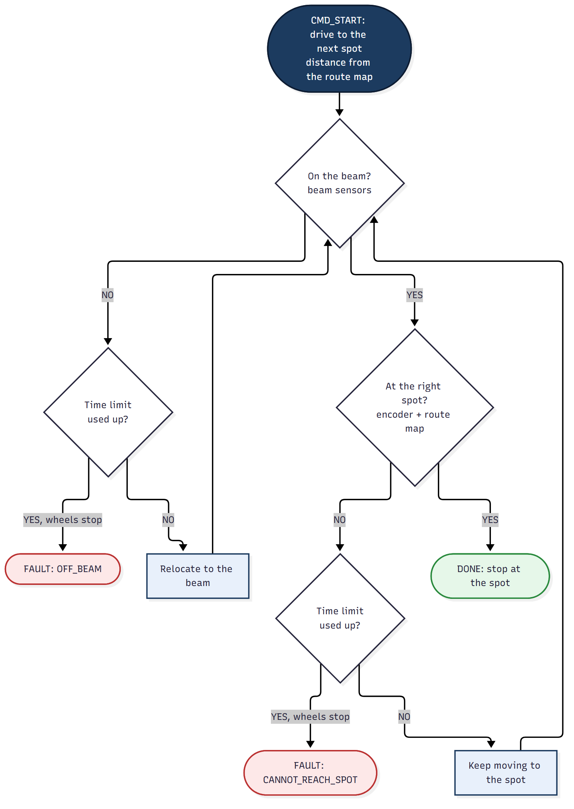

**Turn to the next row (only at the end of a row).** Turn 90, drive forward until the front sensor has counted the planned number of crests, check the encoder against the planned row gap (a mismatch means the wrong crest was counted, so the turn fails), then turn 90 again in the same direction. The directions alternate: right twice, then left twice, and so on.

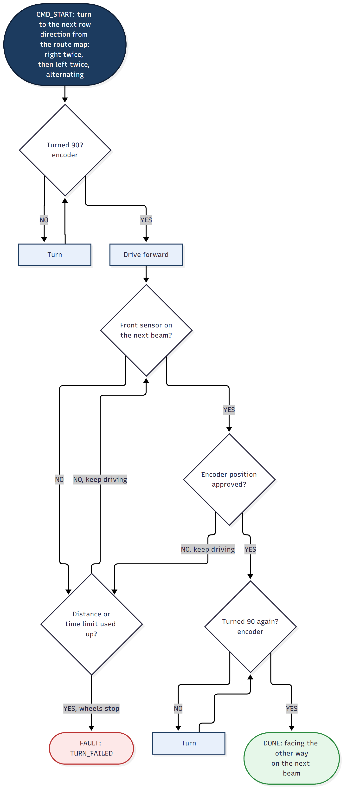

- **Sensors:** crest sensors (on the crest?), front sensor (on the next crest?), encoders (distance and turn angle).
- **Faults:** `OFF_CREST`, `CANNOT_REACH_SPOT`, `OVERSHOT_SPOT`, `NOT_ALIGNED`, `TURN_FAILED`. These have no skip option.
- **Handoff:** after straight `DONE`, the Supervisor starts Plate. After turn `DONE`, the Supervisor drives straight on the new row.

### 3.3 Plate

Plate puts one plate into the fastening position.

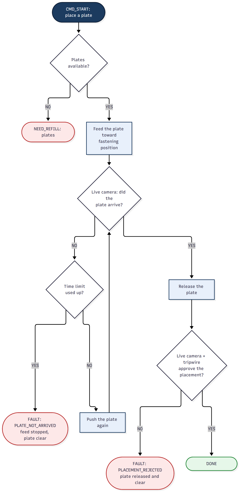

1. Check that plates are available. If not, report `NEED_REFILL` straight away.
2. Feed the plate toward the fastening position. The **live camera** must see it arrive. If it does not, push again until a time limit, then report `PLATE_NOT_ARRIVED` (a jam).
3. Release the plate. The **live camera and tripwire** must approve the placement, or it reports `PLACEMENT_REJECTED`.

- **Handoff:** after `DONE`, the Supervisor starts Screw.

### 3.4 Screw

Screw loads one screw so it sits with the plate.

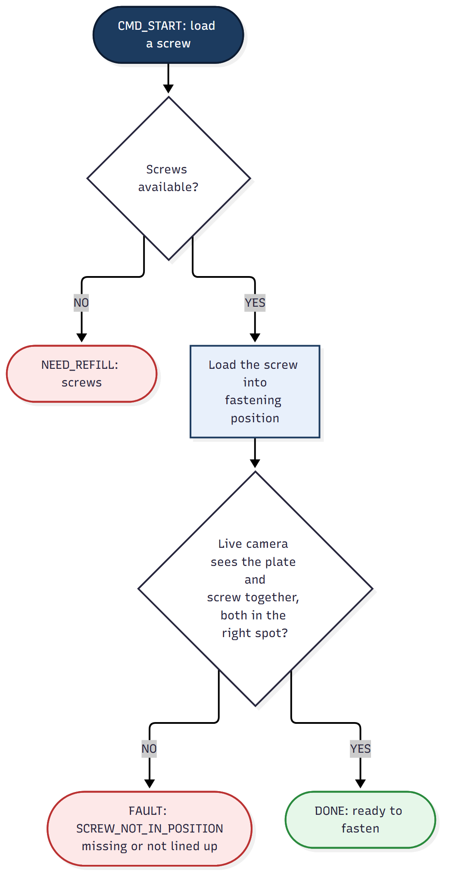

1. Check that screws are available. If not, report `NEED_REFILL` straight away.
2. Load the screw into the fastening position.
3. The **live camera sees the plate and screw together** and must confirm both are in the right spot, before fastening. If not, it reports `SCREW_NOT_IN_POSITION`. This also catches a plate that has shifted.

- **Handoff:** after `DONE`, the Supervisor starts Fastening.

### 3.5 Fastening

Fastening drives the screw in and checks the result.

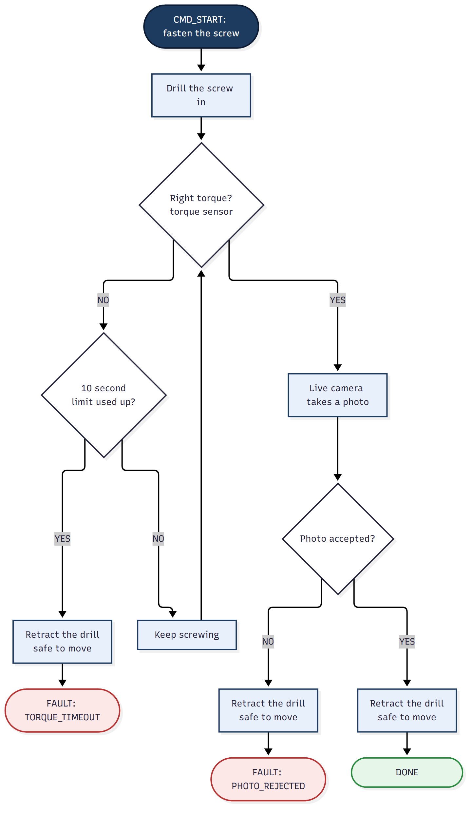

1. Drill the screw in. The torque sensor must reach the right torque within **10 seconds**, or the drill retracts and it reports `TORQUE_TIMEOUT`.
2. When the torque is right, the **live camera takes a photo**. If it is not accepted, the drill retracts and it reports `PHOTO_REJECTED`.
3. If accepted, the drill retracts and it reports `DONE`.

- **Handoff:** after `DONE`, the Supervisor checks the route map. It either drives straight to the next spot, turns to the next row, or finishes the run.

### 3.6 Live camera and light

One camera in an enclosure, with its own light, watches the fastening area and streams all the time. The plate and screw end up in the same area, so it sees both. Plate, Screw, and Fastening each ask it a question (did the plate arrive? are the plate and screw in the right spot? take the photo), and it also streams to the operator screen. The Supervisor checks that the feed is alive. Full details are in section 2.

### 3.7 Operator screen, Start button, and E-stop

- **Start button:** the operator presses it in IDLE to begin the run (the robot starts at the bottom left).
- **Operator screen:** shows alerts (spot, subsystem, fault code), the fault history, and the live camera view. It is where the operator presses **RESOLVED** or **SKIP SPOT**.
- **E-stop:** stops everything immediately, from any state.

### 3.8 Stack light

The operator will often be walking the roof and will not have the operator screen in view the whole time. A **stack light** (a column of coloured lamps) is mounted on the robot so its status can be seen from a distance.

- **It is output only.** The Supervisor sets the light from its own state. The light sends nothing back and no subsystem controls it.
- **It does not replace the alert.** The light says *that* the robot needs attention. The operator screen still says *what* (spot, subsystem, fault code, live feed).

Proposed meaning (to be confirmed, see section 10). If the Supervisor stops talking to the robot's controller, the controller shows flashing amber by itself:

| Light | Robot state | Meaning for the operator |
|---|---|---|
| **Green** (steady) | Running (DRIVE, PLATE, SCREW, FASTEN, TURN) | All good, no action needed |
| **Amber** (flashing) | WAIT_OPERATOR (retries used up, `NEED_REFILL`, locomotion fault, `CAMERA_FEED_LOST`) | The robot has stopped and needs you. Check the screen |
| **Red** (steady) | E-stop pressed | Everything is stopped. Check the robot, reset, press START |
| **Green** (flashing) | IDLE or RUN_COMPLETE | Waiting for START, or the run is finished and the log is ready to review |

---

## 4. How the subsystems work together

### 4.1 Who talks to whom

| Link | Messages |
|---|---|
| Operator to Supervisor | `START`, `RESOLVED`, `SKIP_SPOT` |
| E-stop to Supervisor | `ESTOP` |
| Supervisor to operator screen | `ALERT` (spot, subsystem, fault code), fault history |
| Supervisor to a subsystem | `CMD_START` (which step, which spot), `CMD_ABORT` |
| A subsystem to Supervisor | `DONE`, `FAULT` (with a code), `NEED_REFILL` (plates or screws) |
| Plate, Screw, Fastening to the camera | A question ("is the plate in position?", "are the plate and screw in the right spot?", "take the photo") |
| Camera to those subsystems | The answer |
| Camera to Supervisor | "Feed is alive" |
| Camera to operator screen | Live video |
| Supervisor to stack light | Light colour and pattern, set from the Supervisor's state |
| **Subsystem to subsystem** | **None. Everything goes through the Supervisor.** |

### 4.2 Message reference

| Message | From to | Meaning |
|---|---|---|
| `START` | Operator to Supervisor | Begin the run from IDLE |
| `CMD_START` | Supervisor to subsystem | Do your step now, at this spot. Also used to retry or resume. |
| `CMD_ABORT` | Supervisor to subsystem | Stop what you are doing, safely |
| `DONE` | Subsystem to Supervisor | My step is finished and I am in a safe state |
| `FAULT` (code) | Subsystem to Supervisor | My step failed, and this is why |
| `NEED_REFILL` (plates or screws) | Plate or Screw to Supervisor | The supply is empty, so retrying will not help |
| `ALERT` | Supervisor to operator screen | The robot has stopped: spot, subsystem, fault code |
| `LIGHT` | Supervisor to stack light | Set the stack light colour and pattern (steady or flashing). Output only, no reply. |
| `RESOLVED` | Operator to Supervisor | I fixed it, so resume the same step |
| `SKIP_SPOT` | Operator to Supervisor | I cannot fix this spot, so log it and move on (not allowed for E8 and E9) |
| `ESTOP` | E-stop to Supervisor | Stop everything now |

### 4.3 The rules that tie it together

1. **One step at a time.** Only one subsystem is active at any moment.
2. **Fixed order.** Drive, then Plate, then Screw, then Fastening, then the row check.
3. **Nothing moves until the last step is done and safe.** The Supervisor starts Locomotion only after Fastening has reported `DONE` with the drill retracted. It starts Screw only after the plate is approved, and Fastening only after the plate and screw are confirmed in the right spot.
4. **Subsystems check their own work.** The Supervisor trusts `DONE` and `FAULT` and does not repeat the checks.
5. **Retries belong to the Supervisor.** A subsystem just reports each attempt. The Supervisor counts to 2.
6. **Every fault carries a code.** The Supervisor adds the spot number, so the operator sees "Spot 8, Plate, `PLACEMENT_REJECTED`".
7. **Only the operator clears a stop.** The robot never moves on by itself after a failure.
8. **The E-stop overrides everything.**
9. **The camera is a dependency.** If the feed is lost, the robot stops (E9).
10. **The stack light follows the Supervisor's state.** It is output only, and no subsystem controls it (section 3.8).

### 4.4 One spot, step by step

| # | Who | What happens | Message |
|---|---|---|---|
| 1 | Supervisor to Locomotion | Drive to the next spot | `CMD_START` |
| 2 | Locomotion | Check on the crest, drive to the spot, stop | `DONE` |
| 3 | Supervisor to Plate | Place a plate | `CMD_START` |
| 4 | Plate with camera | Feed plate, camera confirms arrival, release, camera + tripwire approve placement | `DONE` |
| 5 | Supervisor to Screw | Load a screw | `CMD_START` |
| 6 | Screw with camera | Load screw, camera confirms the plate and screw are both in the right spot | `DONE` |
| 7 | Supervisor to Fastening | Drive the screw in | `CMD_START` |
| 8 | Fastening with camera | Drill to the right torque, camera takes the photo, drill retracts | `DONE` |
| 9 | Supervisor | Check the route map: more spots in the row, end of the row, or last spot | (decision) |

If every step goes well, step 9 sends the robot back to step 1 for the next spot. A failure at any step is covered in section 8.

### 4.5 End of a row

When the route map says the row is finished, the Supervisor sends `CMD_START` (turn to next row) to Locomotion. Locomotion turns, drives onto the next crest, turns again, and reports `DONE`. The robot is now facing the other way on the next row, and the Supervisor continues from step 1 above. The turns are right twice, then left twice on the next row, alternating.

### 4.6 When something goes wrong

A failed step is retried up to 2 times in place. If it still fails, or something is empty, or the camera feed is lost, the robot **stops where it is** and sends an alert with the live view. The operator fixes it and presses `RESOLVED` to resume the same step. Section 6 has the full rule, and section 8 has one diagram for each error.

### 4.7 Time limits

| Limit | Value |
|---|---|
| Retries per step (N) | 2 |
| Torque reached (Fastening) | 10 seconds |
| Relocate to the crest, reach the spot, finish a turn (Locomotion) | Not set yet, to be found in testing |
| Plate arrival and screw position checks | Not set yet, to be found in testing (depends on the camera delay) |

---

## 5. A normal run (no errors)

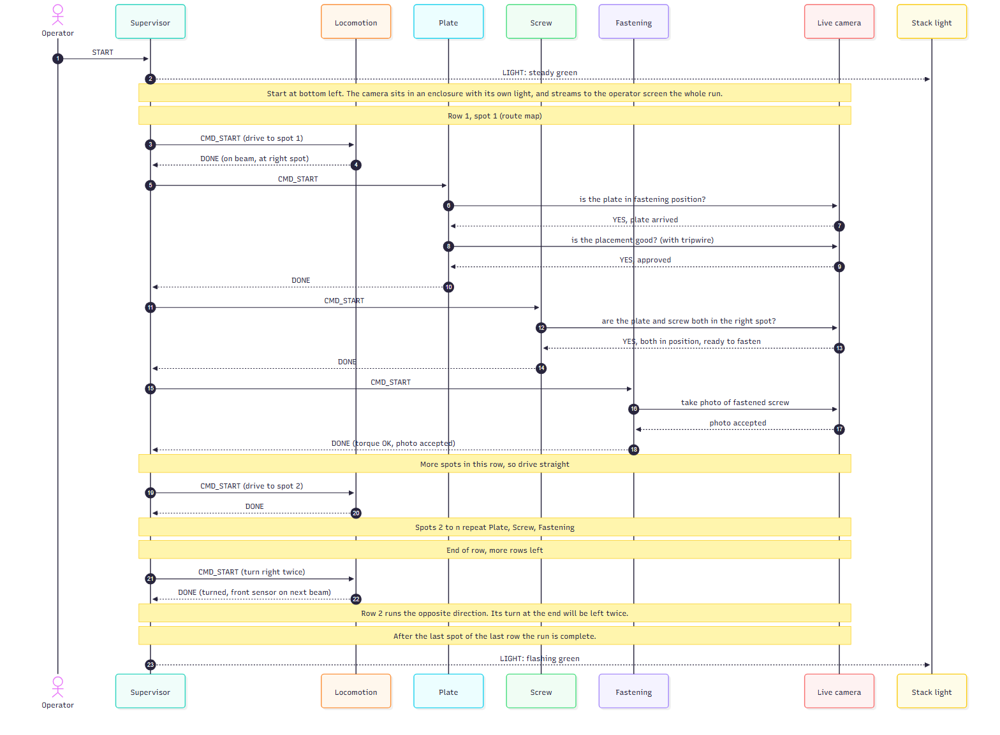

### How to read the Supervisor state chart

The Supervisor is a **state machine**. At any moment it is in exactly one box (a *state*), and an arrow (a *transition*) moves it to another box when the label on the arrow happens. The chart is shown twice: first the normal flow only, then the full chart with faults.

#### Normal flow only (no errors)

Read it top to bottom. This is the mowing-lawn loop.

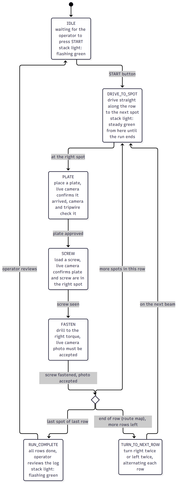

1. **IDLE.** The robot is powered and waiting. The operator presses START.
2. **DRIVE_TO_SPOT.** The robot drives straight along the row to the next spot.
3. **PLATE, SCREW, FASTEN.** At the spot it does the three jobs in order, each confirmed by the live camera. Each one must finish before the next starts.
4. **The diamond (row check).** After fastening, the Supervisor asks "where am I in the row?" using the route map:
   - *More spots in this row:* go back to DRIVE_TO_SPOT (the loop on the right side).
   - *End of the row, more rows left:* go to TURN_TO_NEXT_ROW, then DRIVE_TO_SPOT on the next crest, now heading the other way.
   - *Last spot of the last row:* go to RUN_COMPLETE, where the operator reviews the log.

#### Full chart, with faults

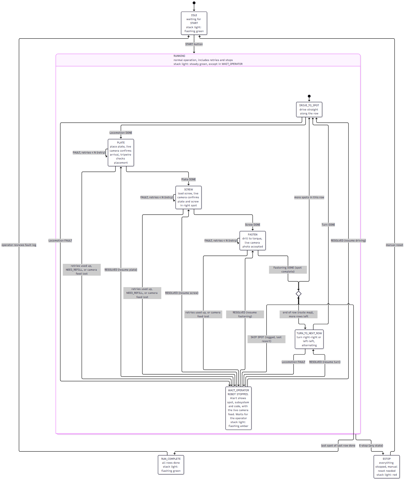

The full chart is the same loop plus three extra behaviours. Look for these:

| Look for | What it means |
|---|---|
| **A small arrow looping back onto PLATE, SCREW or FASTEN**, labelled "FAULT, retries < N" | The step failed, so the robot **retries it in place**. It does not move. |
| **Arrows going down into WAIT_OPERATOR** | The robot **stops**. This happens when retries are used up, when plates or screws run out (`NEED_REFILL`), when the **camera feed is lost**, or when locomotion faults (off the crest, cannot reach the spot, turn failed). The operator screen shows the spot, the subsystem, the fault code, and the live camera feed. |
| **Arrows leaving WAIT_OPERATOR** | The operator decides. **RESOLVED** sends the robot back to the exact step that stopped (one arrow per step). **SKIP SPOT** sends it to the row check and is the last resort. |
| **The ESTOP box, outside the pink RUNNING box** | The E-stop can be pressed from anywhere inside RUNNING. Everything stops, and only a manual reset returns the robot to IDLE. |

**The pink RUNNING box** groups everything that happens during a run, so a single arrow (the E-stop) can leave from all of it.

#### The stack light

The stack light (section 3.8) follows the same states: green steady while the robot is in the main loop, flashing amber in WAIT_OPERATOR, red in ESTOP, and flashing green in IDLE and RUN_COMPLETE.

#### Three loops to remember

1. **Main loop:** DRIVE, PLATE, SCREW, FASTEN, row check, back to DRIVE. This is the normal run.
2. **Retry loop:** a step loops back to itself up to 2 times. The robot is still working and nobody needs to do anything.
3. **Stop loop:** a step goes to WAIT_OPERATOR and returns to that same step after the operator fixes it. The robot is paused and a person has to act.

---

## 6. The error rule

The robot **never moves on by itself after a failure**. The rule has four parts:

1. **Retry in place.** A failed step is retried at the same spot up to **N** times (**N = 2**).
2. **Stop and alert.** If retries run out, something is empty (plates or screws), or the camera feed is lost, the robot **stops where it is** and the operator screen shows: *spot, subsystem, fault code*, plus the live feed.
3. **Operator fixes it, then resumes.** The operator fixes the problem on the robot and presses **RESOLVED**. The robot resumes the **same step** at the same spot.
4. **Skip is manual and a last resort.** If a spot cannot be fixed, the operator can press **SKIP SPOT**. It is logged so the spot can be revisited. The robot never skips on its own.

One safety rule applies to every subsystem: **before it reports a FAULT, it returns to a safe-to-move state** (drill retracted, plate released, wheels stopped).

## 7. Summary of all errors

| # | Error | Subsystem | Fault code | Retries (N = 2) | After retries |
|---|---|---|---|---|---|
| E1 | Plate did not arrive (jam), seen by the live camera | Plate | `PLATE_NOT_ARRIVED` | Feed plate again | Stop and alert |
| E2 | Plate placement rejected | Plate | `PLACEMENT_REJECTED` | Push plate again | Stop and alert |
| E3 | Out of plates | Plate | `NEED_REFILL` | None | Stop and alert |
| E4 | Screw missing or not in the right spot (live camera sees the plate and screw together) | Screw | `SCREW_NOT_IN_POSITION` | Reload and realign screw | Stop and alert |
| E5 | Out of screws | Screw | `NEED_REFILL` | None | Stop and alert |
| E6 | Torque not reached in 10 seconds | Fastening | `TORQUE_TIMEOUT` | Drive screw again | Stop and alert |
| E7 | Photo rejected | Fastening | `PHOTO_REJECTED` | Retake photo | Stop and alert |
| E8 | Lost the crest, or cannot reach the spot or finish the turn | Locomotion | `OFF_CREST`, `CANNOT_REACH_SPOT`, `OVERSHOT_SPOT`, `NOT_ALIGNED`, `TURN_FAILED` | Relocate (not for `OVERSHOT_SPOT`) | Stop and alert (no skip) |
| E9 | Live camera feed lost, lens blocked, or image too dark (light failed) | Camera (watched by the Supervisor) | `CAMERA_FEED_LOST` | None | Stop and alert (no skip) |
| E10 | Emergency stop | Any | `ESTOP` | None | Everything stops. Manual reset |

Every stop in this table (E1 to E9) turns the stack light to **flashing amber**, and E10 turns it **red**, so the operator can see from a distance that the robot needs them (section 3.8).

In E1 to E7 the operator can press **RESOLVED** (resume) or **SKIP SPOT** (last resort). E8 has no skip, because every later spot depends on the robot being on the crest. E9 has no skip, because nothing can be verified without the camera.

---

## 8. Each error

### E1: Plate did not arrive (jam)

**When:** a plate is being fed toward fastening position and the live camera does not see it arrive. This is the jam case the camera was added for. It is caught **before** the robot tries to place the plate.
**Robot does:** stops the feed and feeds the plate again (up to N). If it still fails, it stops and alerts.
**Operator does:** watches the live feed, clears the jam, then presses RESOLVED. If it cannot be cleared, they press SKIP SPOT.

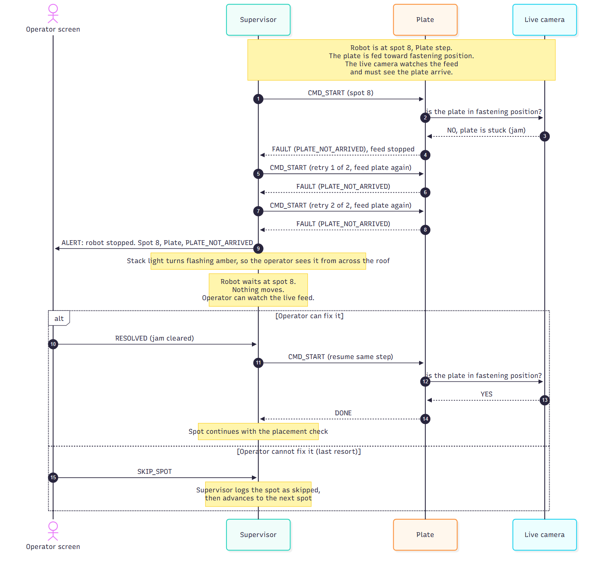

### E2: Plate placement rejected

**When:** the plate arrived and was pushed into place, but the live camera + tripwire do not approve the placement.
**Robot does:** releases and clears the plate, pushes it again (up to N). If it still fails, it stops and alerts.
**Operator does:** fixes the plate on the robot, then presses RESOLVED. If the plate cannot be placed, they press SKIP SPOT.

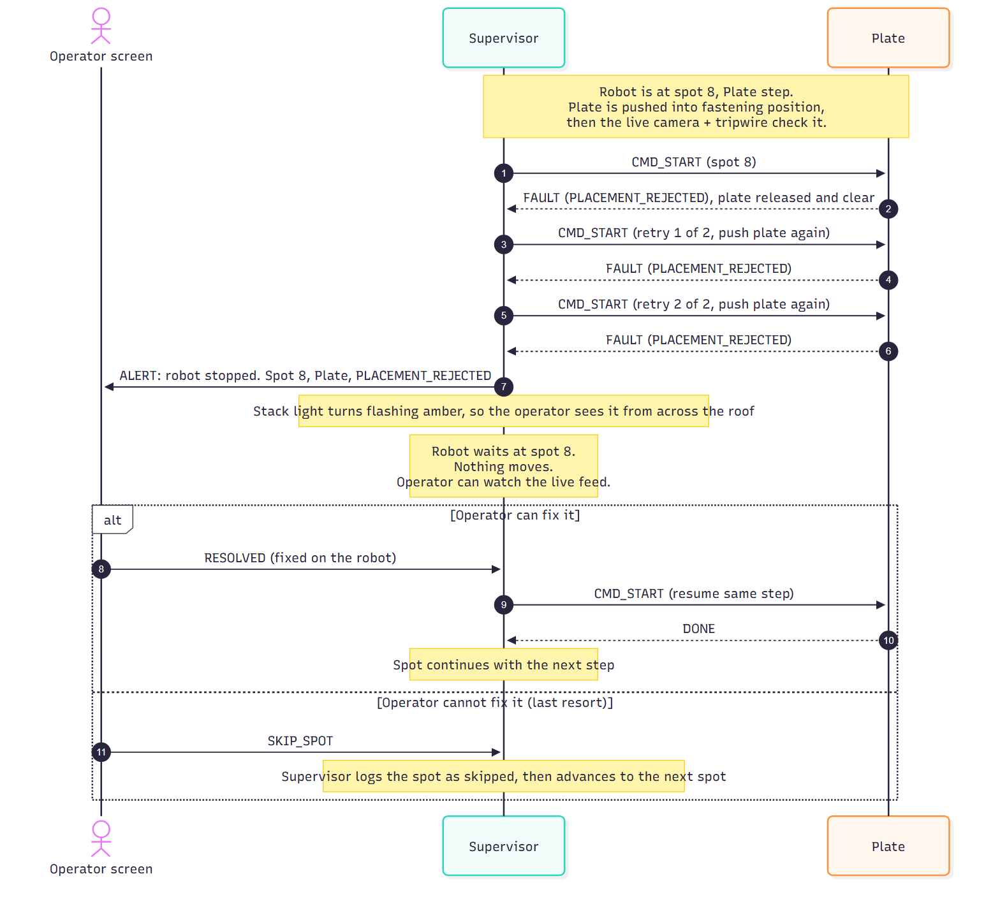

### E3: Out of plates

**When:** the Plate step starts and there are no plates left to load.
**Robot does:** stops immediately and alerts. It does not retry, because retrying cannot help.
**Operator does:** refills the plates, then presses RESOLVED. The Plate step resumes.

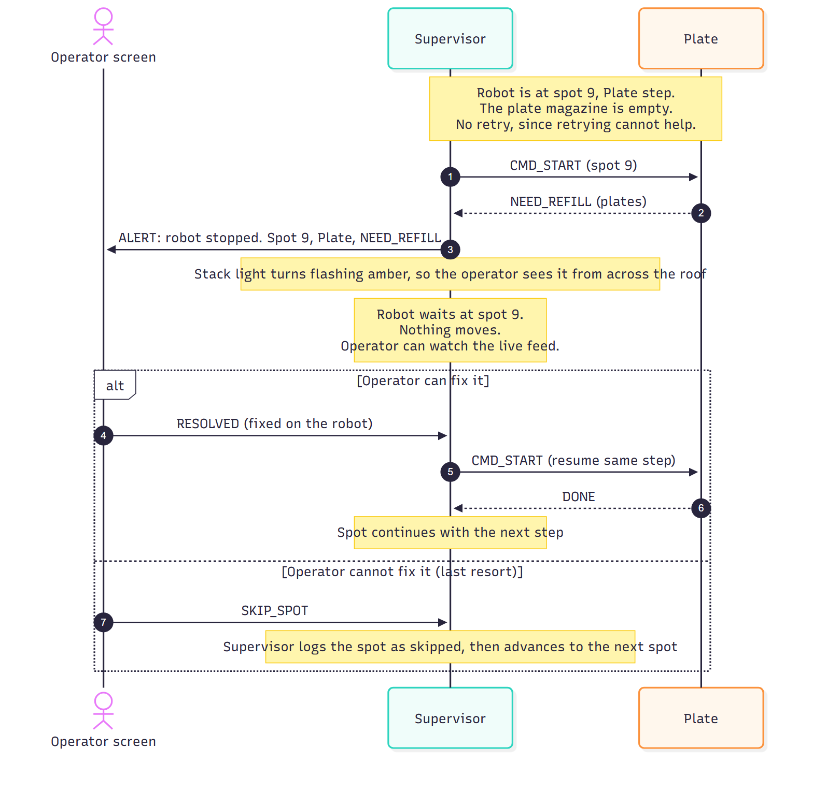

### E4: Screw missing or not in the right spot

**When:** a screw was loaded, but the live camera, looking at the plate and screw together, does not see the screw there or does not see both in the right spot. The cause can be the screw (missing, or not lined up with the plate) or the plate (it moved after it was placed). This check runs **before fastening starts**.
**Robot does:** reloads and realigns the screw (up to N). If it still fails, it stops and alerts.
**Operator does:** watches the live feed, checks **both** the plate and the screw, clears whatever is wrong (for example a jam or a shifted plate), then presses RESOLVED. If it cannot be fixed, SKIP SPOT.

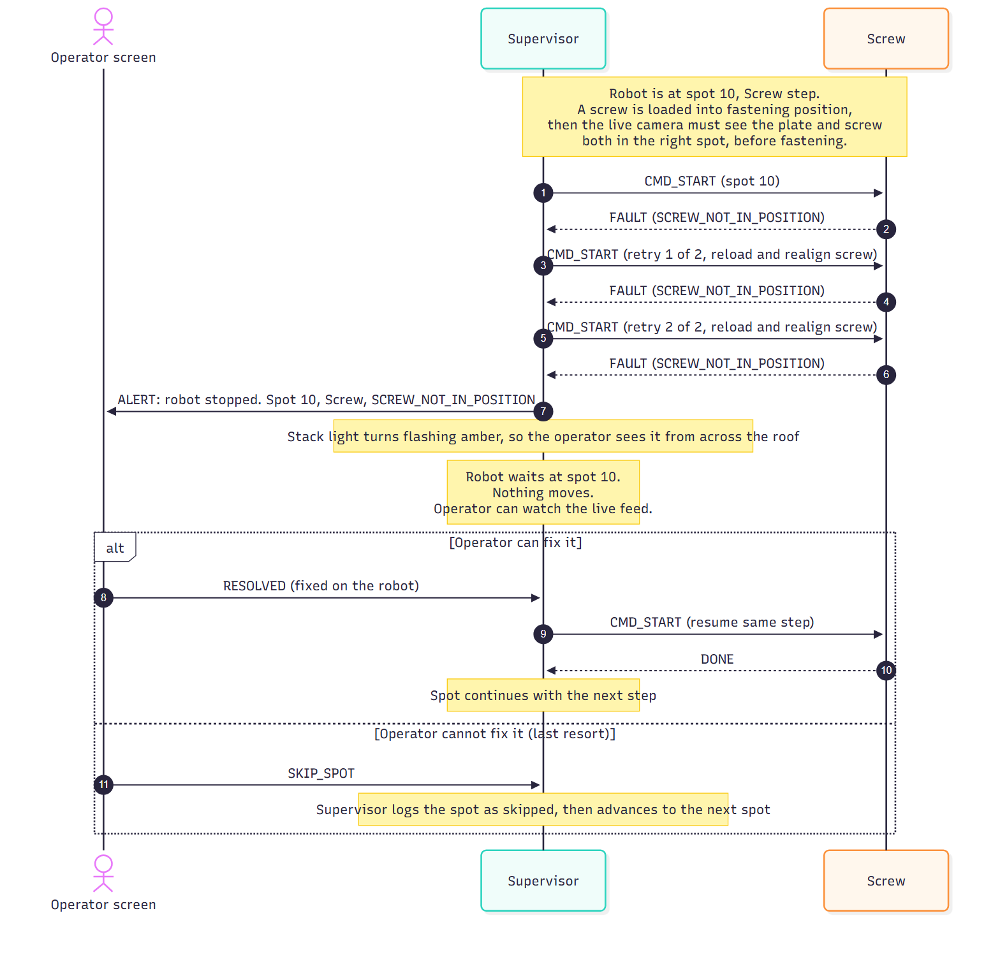

### E5: Out of screws

**When:** the Screw step starts and the supply is empty.
**Robot does:** stops immediately and alerts. No retry.
**Operator does:** refills the screws, then presses RESOLVED. The Screw step resumes.

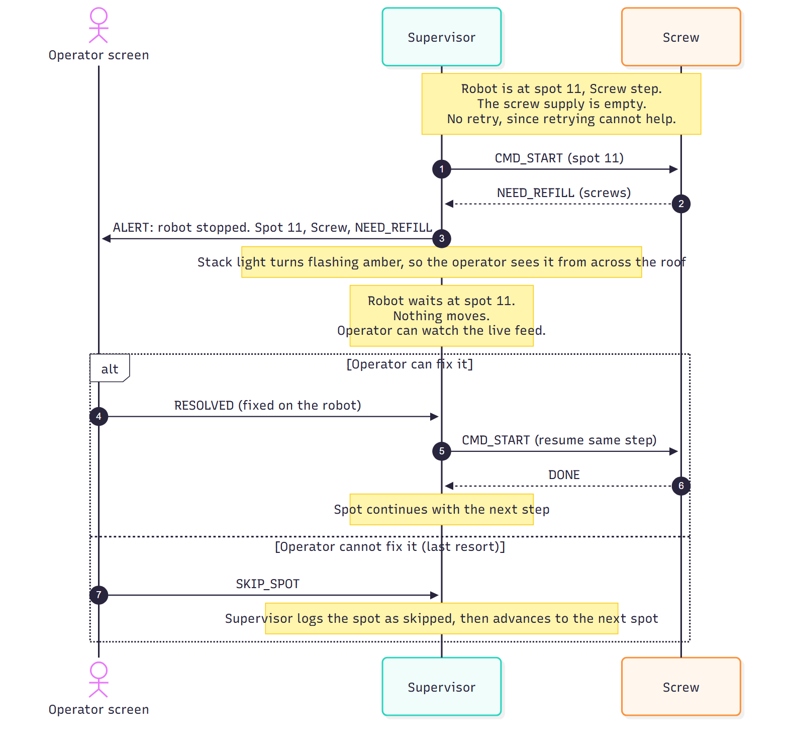

### E6: Torque not reached

**When:** the drill is driving the screw but the right torque is not reached within **10 seconds**. In your original flow this is the "keep screwing" loop, which had no exit. The 10 second limit is the new part, and will be tuned in testing.
**Robot does:** retracts the drill (safe state) and drives the screw again (up to N). If it still fails, it stops and alerts.
**Operator does:** checks the screw and drill (for example a stripped screw), then presses RESOLVED. If it cannot be fixed, SKIP SPOT.

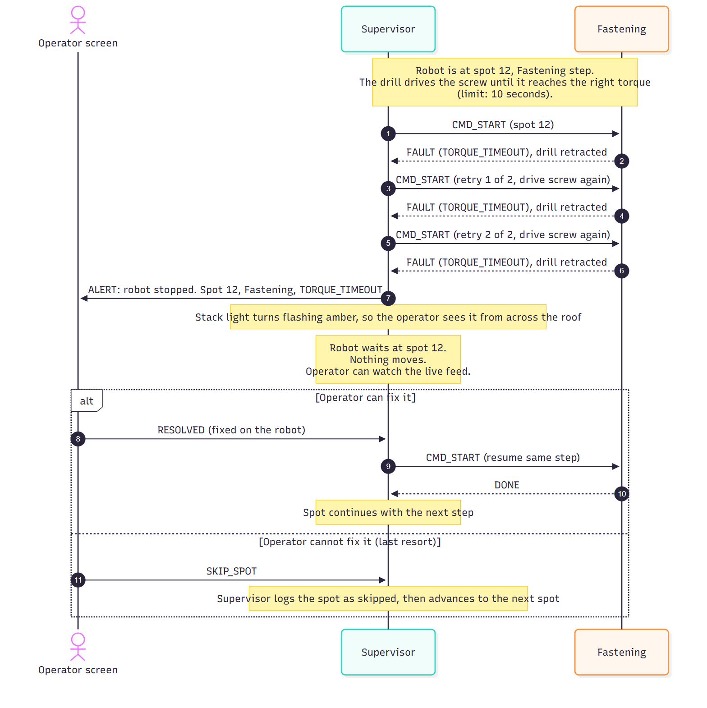

### E7: Photo rejected

**When:** the screw reached the right torque, but the live camera's photo of it is not accepted.
**Robot does:** retakes the photo (up to N). If it still fails, it stops and alerts.
**Operator does:** checks the screw on the live feed or by eye (and cleans the camera if needed), then presses RESOLVED. If the screw is fine but the photo cannot be accepted, they can SKIP SPOT so it is logged for review.

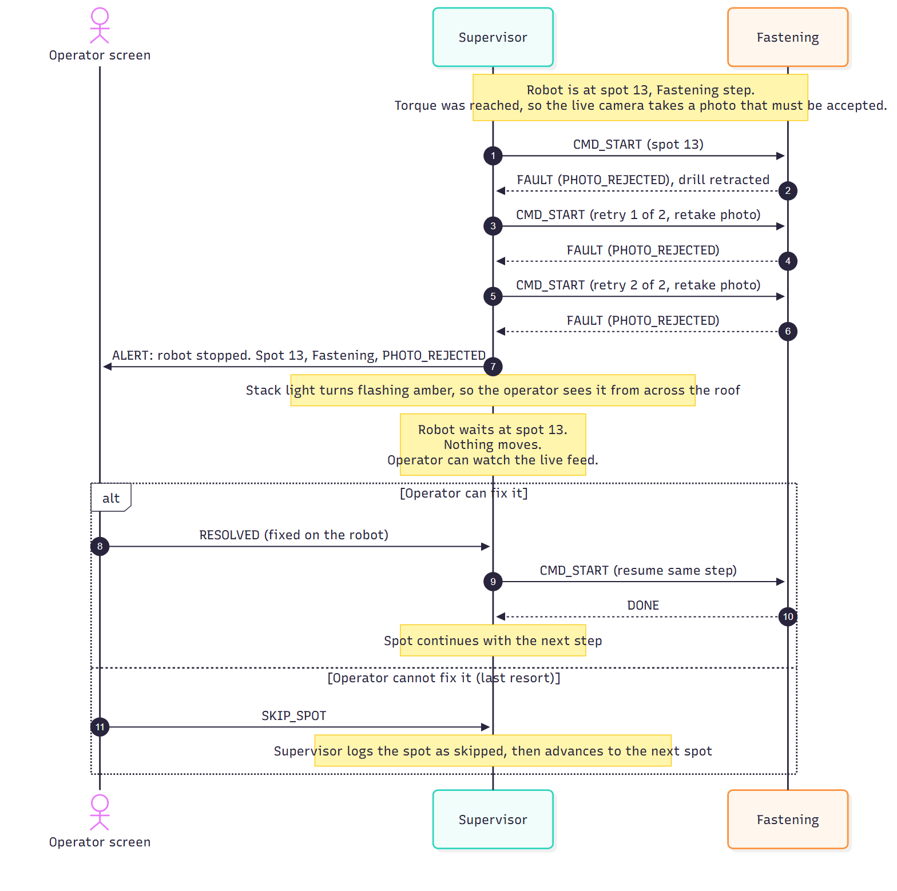

### E8: Locomotion fault

**When:** the robot is driving along a row or turning onto the next row and cannot stay on the crest, cannot reach the right spot, or the turn fails (front sensor not on the next crest, or the encoder does not approve).
**Robot does:** stops the wheels, tries to relocate to the crest (up to N), then stops and alerts. **Exception, `OVERSHOT_SPOT`:** the robot rolled past the spot. A retry would repeat the whole drive from where the robot now is, past the spot, so it would end up even further past. It stops and alerts at once, with no retries.
**Operator does:** places the robot back on the crest, then presses RESOLVED. After `OVERSHOT_SPOT`, puts the robot back where the drive started (the drive is repeated in full). **There is no skip here.**

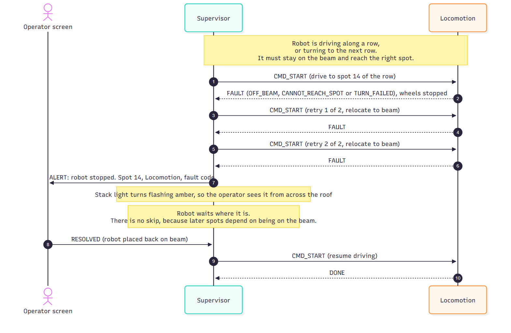

### E9: Live camera feed lost

**When:** at any time during a run, the camera stops sending frames, its lens is blocked, or the image goes too dark (for example the light fails). The Supervisor notices because it checks that the feed is alive and usable.
**Robot does:** stops the current step safely and alerts. There is no retry and no skip, because plate, screw, and photo checks cannot be verified without the camera.
**Operator does:** cleans the lens, fixes the cable, or replaces the light, confirms the feed is back, then presses RESOLVED. The robot resumes the same step.

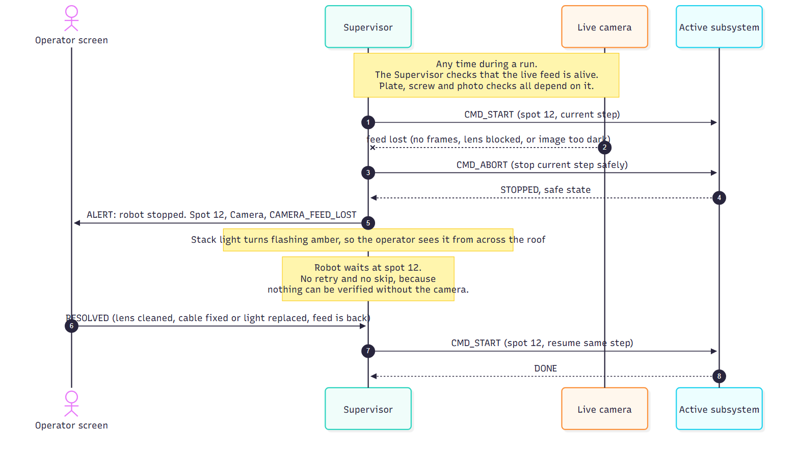

### E10: Emergency stop

**When:** the E-stop is pressed, at any time and in any state.
**Robot does:** the Supervisor sends `CMD_ABORT` to every subsystem and all actuators stop. The robot does **not** resume the step, because its position and progress are no longer trusted.
**Operator does:** checks the robot, does a manual reset (back to IDLE), and presses START again.

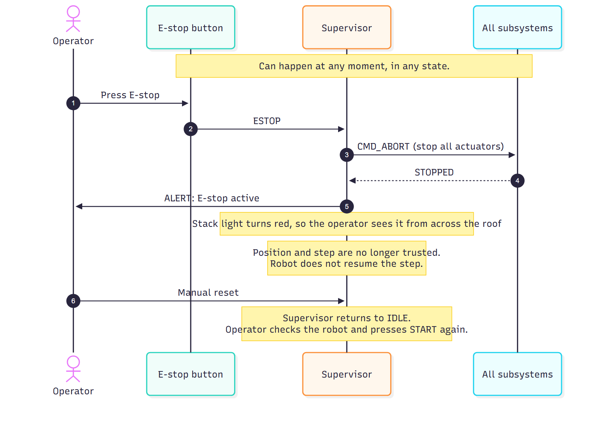

---

## 9. Decisions made

| Question | Decision |
|---|---|
| Turn direction | Turn right twice at the end of the first row, then left twice at the end of the next, alternating every row. |
| Start position | Bottom left or bottom right of the roof. The robot starts there and follows the programmed path. |
| End-of-row detection | The **route map** programmed into the robot gives the number of spots in each row and the distances between them. The Supervisor counts spots against it, so no extra end-of-crest sensor is needed. |
| N (retries) | **2**, for now. |
| Torque time limit | **10 seconds**, for now. To be tested and tuned. |
| Skip after a rejected photo (E7) | Acceptable, as long as it is logged. |
| Retry actions | Accepted as written: plate re-fed or re-pushed, screw reloaded, drill re-engaged, photo retaken, robot relocated. |
| Live camera | **Used, one camera.** The plate and screw end up in the same area, so one camera sees both before fastening. It streams continuously, confirms the plate arrived (to avoid jamming), approves placement, checks the plate and screw together before fastening, takes the final photo, and shows the operator what is happening. |
| Camera lighting | The camera is in an **enclosed space**, so glare and sunlight are not an issue. A **light** inside the enclosure keeps the picture steady. |
| Stack light | A **stack light** is mounted on the robot so the operator can see its status from a distance, since they may not have the operator screen in view while on the roof. The Supervisor drives it from its state (section 3.8). |
| Camera view | The base where the systems meet is being built around the camera, so the plate pusher, screw loader, and drill will not block its view. |

## 10. Still open

- **Frame rate and delay.** The "plate arrived" and "plate and screw in the right spot" checks only help if the camera can decide fast enough, so the delay (latency) should be measured in testing. **You are looking into this and will report back.** The diagrams and the retry count may need a small update once the number is known.
- **Light failure.** I assumed a failed light (image too dark) is handled as a camera fault (E9). Confirm that is what you want.
- **Sensor roles.** I assumed the plate and screw sensors tell the subsystem whether the supply is empty, and that the tripwire helps approve plate placement. Confirm what each sensor really does.
- **Stack light meanings.** The colours and patterns in section 3.8 are my proposal. Confirm them, and whether you want a buzzer too, or different colours for a refill stop versus a fault stop.
- **Time limits.** Only the 10 second torque limit is set. The Locomotion limits (relocate, reach the spot, turn) and the plate and screw arrival limits still need values from testing.

**See also.** Since this guide was written, the control system has been built in simulation and the firmware has been written. The hardware decisions, the message format, the code, the extra behaviors added beyond this guide, and the full list of next steps are in `../project/next_steps.md`, `hardware_architecture.md` and `../software/message_schema.md`. Start from `../../README.md`.
