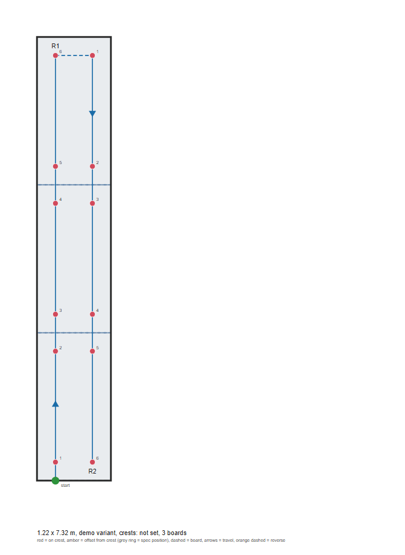
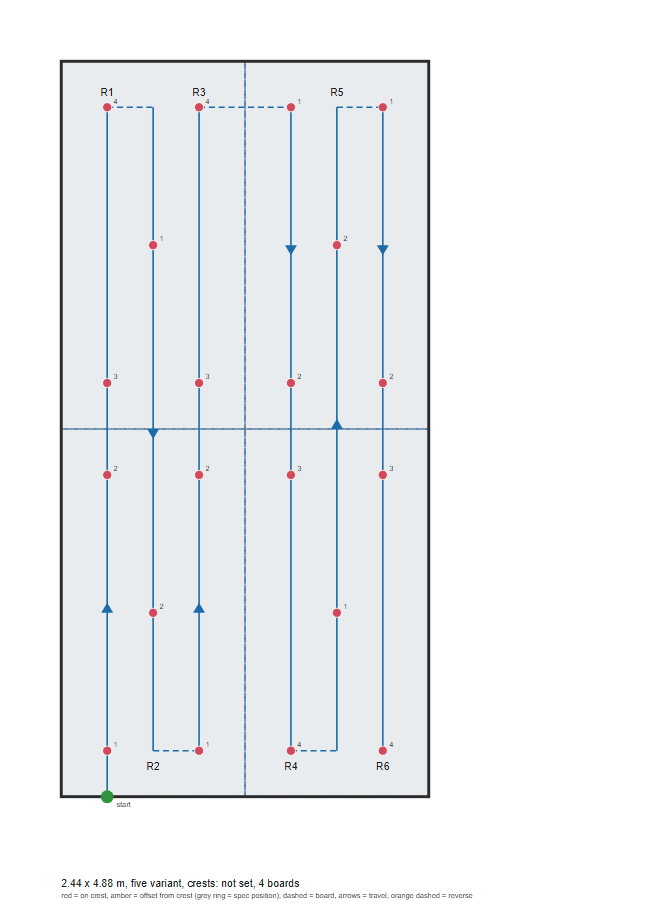
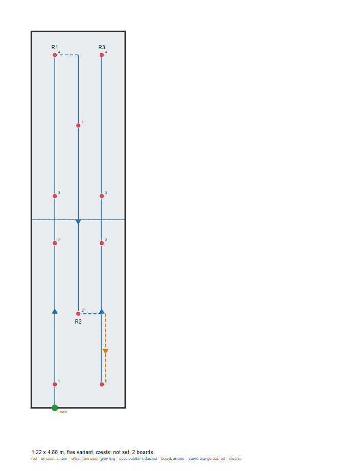
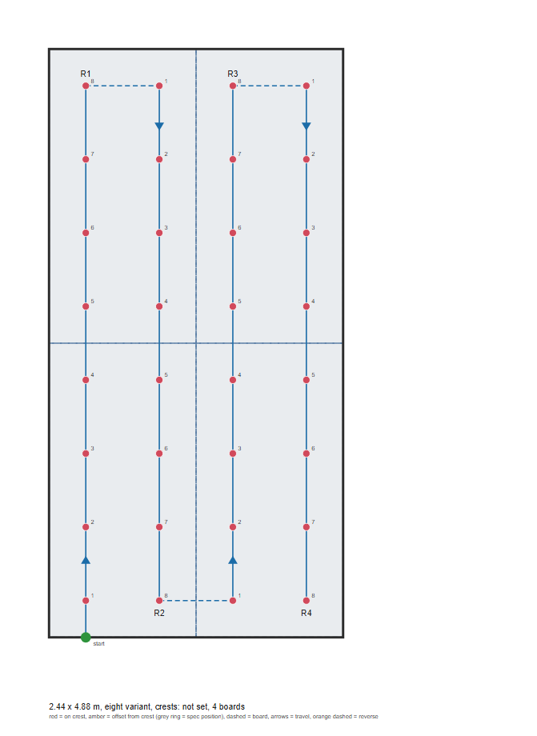
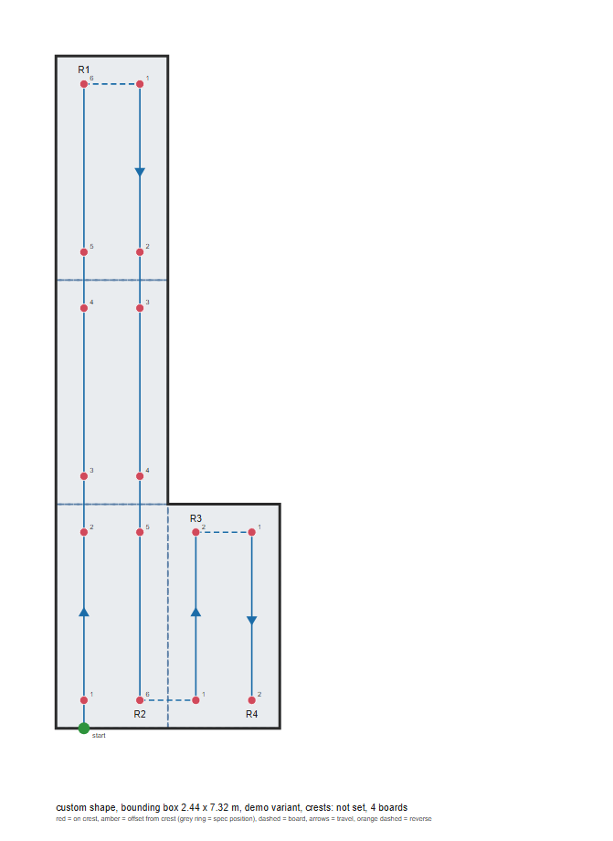
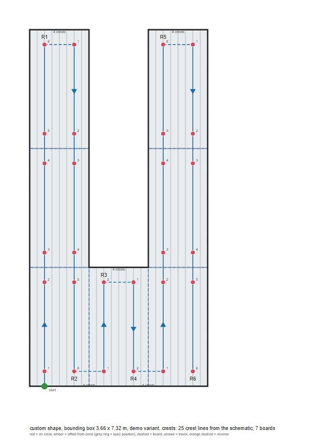
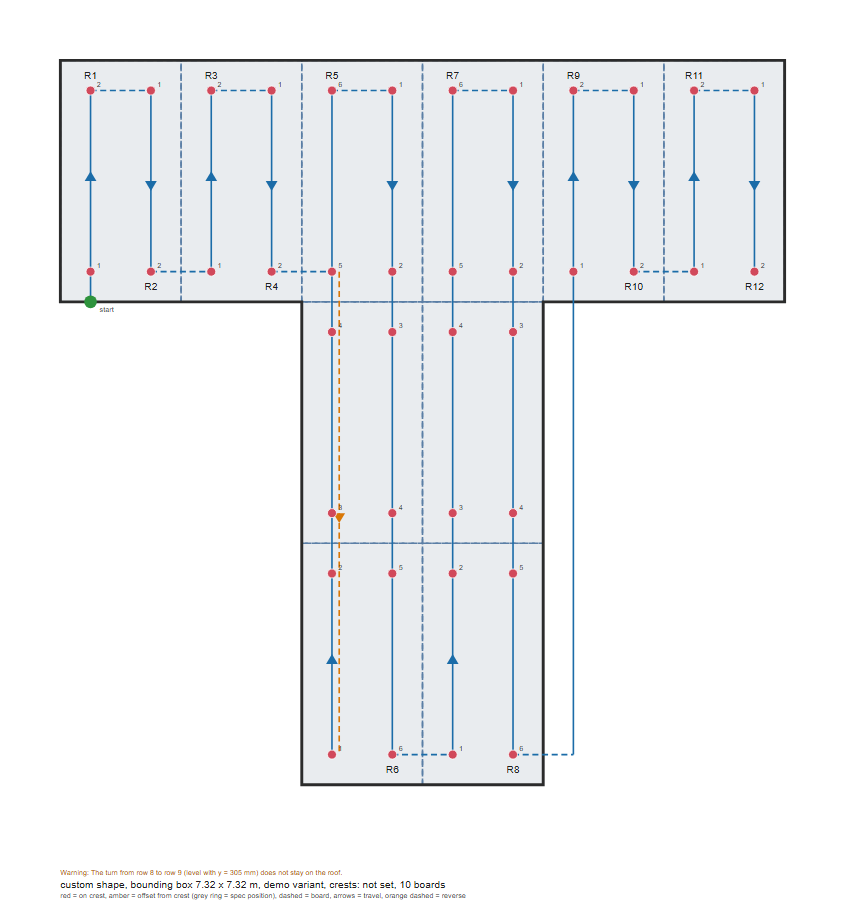

# Path planning: findings

Where the path planning stands as of 2026-11-10, written for presenting. Every claim is marked as **verified** (checked by a test or by running it), **modelled** (a result from the accuracy model, which rests on placeholder numbers) or **assumed** (not yet checked against a real roof, a real schematic or the robot). All figures in this document were generated by the planner itself (`docs/figures/`, made by running the code, not drawn by hand).

## 1. The problem

The robot drives a lawnmower pattern over flat roof boards, along the flutes of the steel deck beneath, and puts a screw through a **crest** at each fastening spot. The fastener positions come from the Carlisle MF-27 detail, per 4 x 8 ft board. The screw line has to land within **+/-0.5 mm** of the crest centre (decision N4, may change). The deck is hidden under the boards, so position cannot be seen directly: it comes from a crest sensor array, wheel encoders and the known layout.

The planning question: given a roof, which spots get screws, in what order does the robot visit them, and what does it have to be told so it can do that?

## 2. The approach

```
roof schematic (typed size, drawn shape, or SVG / DXF file)
   -> roof outline  +  real crest positions (or an even flute pitch)
   -> whole 4 x 8 ft boards that fit inside the outline (respecting a setback)
   -> the MF-27 fastener pattern stamped on each board (5, 8, or 4 "demo" screws)
   -> strips: each column of screws along the flutes, snapped to its crest
   -> turn levels (every strip driven forwards, the same stretch each)
   -> a Route: distances, plus the crest count and sideways gap for every turn
   -> Supervisor / simulator / firmware
```

Decisions that shape it (full list in `design_concept.md`, D14 to D27):

| Decision | Why |
|---|---|
| **Strips run along the flutes**; the robot only crosses flutes when it changes strip | A screw has to land on a crest, so crossing flutes means re-finding a crest at every screw |
| **The planner is outside the Supervisor** (D18). It runs before the run and hands over a `Route` | The Supervisor stays a pure state machine that one implementation runs in the tests, the simulator and on the robot |
| **Whole boards only**, no cut boards | The MF-27 sheet has no cut-board pattern, and the team will only use 4 x 8 ft boards |
| **Every strip covers the same stretch and the robot only stops at screws** (D26). After its last screw a strip runs on to the level where the next strip's first screw is, and turns there | Consistent movement, nothing reverses, and the turn never runs along the roof edge. The 8-screw and 4-screw patterns already line up; only the 5-screw pattern's middle strip runs on |
| **Real crest positions from the schematic**, not an assumed pitch (D23) | The pitch is not measured yet, and a real roof will not be perfectly even |
| **Turn commands carry the crest count and the sideways gap** (D25) | Counting crests alone cannot tell a missed crest from a right one; the encoder check can |

## 3. Results

All plans below were produced by `plan()` and checked by tests. Red dots are screws, numbered in driving order. Blue lines are the strips, with arrows showing the direction of travel; dashed blue lines are the turns, which happen level with a screw, never along the roof edge. Grey lines are crests (an even placeholder pitch, or the real positions where stated).

### 3.1 The demo roof: 3 boards in a line, 4 screws each



12 spots in 2 strips, each strip stopping at six screws. Every later strip starts level with its first screw, so its first drive is zero. **Verified.**

### 3.2 The 5-screw pattern, and why the strips run on



Four boards (8 x 16 ft), 20 spots, 6 strips. The middle strip of each board has only one screw per board, so after fastening it the robot is facing the wrong way for the next strip's first screw. Here each strip runs on to the same end as its neighbours, so the strips are all the same length and the robot only stops at screws. **Verified** (on rectangular roofs no pattern produces a negative distance; every shape and pitch tried gets exactly 5 screws per board). On drawn shapes the planner can still fall back to reversing where running on would leave the roof (section 3.7).

For comparison, turning at the last screw instead (the option "Turn at the last screw") makes the robot reverse 36 in at the start of the third strip:



I checked whether re-ordering the strips could avoid both the reverse and the run-on. By brute force over every strip order, an order with **no reversing exists** for 1, 2 and 3 boards across, but it costs much more sideways travel (crossing flutes is the expensive, error-prone part):

| Boards across | Left to right, with reversing | Zero-reverse order |
|---|---|---|
| 1 | 24 in sideways | 36 in |
| 2 | 72 in | 132 in |
| 3 | 120 in | 228 in |

So running on, in left-to-right order, is the cheaper way to keep movement consistent. **Verified** by the search.

### 3.3 The 8-screw pattern



32 spots in 4 strips. The strips already line up, so there is no run-on. **Verified.**

### 3.4 Other roof shapes



A drawn or imported outline is handled by keeping only the whole boards that fit inside it. Thirteen common shapes are built in. The 4-screw pattern plans all of them; table in section 3.6. **Verified.**

### 3.5 Reading a roof schematic file



The roof outline and the **real crest positions** are read from an SVG or DXF file (here a U-shaped sample with 25 crest lines), and the strips snap to those crests. The file is rotated so the crests run up the page, units come from the file, and bad files are refused with a message. **Verified for files written in the assumed format; the format itself is assumed** (section 5).

### 3.6 Coverage across the shape library

Spots and strips for every built-in shape, with the number of turn warnings the planner raised (demo / 5-screw / 8-screw):

| Shape | Boards | Demo 4-screw | 5-screw | 8-screw | Turn warnings |
|---|---|---|---|---|---|
| Rectangle 8 x 24 ft | 6 | 24 spots / 4 strips | 30 / 6 | 48 / 4 | 0/0/0 |
| Square 16 x 16 ft | 8 | 32 / 8 | 40 / 12 | 64 / 8 | 0/0/0 |
| L shape | 4 | 16 / 4 | 20 / 6 | 32 / 4 | 0/1/0 |
| L shape, wide | 8 | 32 / 8 | 40 / 12 | 64 / 8 | 0/0/0 |
| T shape | 10 | 40 / 12 | 50 / 18 | 80 / 12 | 1/1/1 |
| U shape | 7 | 28 / 6 | 35 / 9 | 56 / 6 | 0/1/0 |
| H shape | 14 | 56 / 12 | 70 / 18 | 112 / 12 | 1/1/1 |
| Plus / cross | 10 | 40 / 12 | 50 / 18 | 80 / 12 | 1/1/1 |
| Z / S shape | 14 | 56 / 12 | 70 / 18 | 112 / 12 | 1/1/1 |
| Staircase | 6 | 24 / 6 | 30 / 9 | 48 / 6 | 0/1/0 |
| Rectangle with a notch | 16 | 64 / 12 | 80 / 18 | 128 / 12 | 0/0/0 |
| Rectangle, one corner cut | 16 | 64 / 12 | 80 / 18 | 128 / 12 | 0/0/0 |
| Trapezoid | 12 | 48 / 8 | 60 / 12 | 96 / 8 | 0/0/0 |

Every shape plans, and the spot count is always exactly pattern x boards. **Verified.** The warnings are the planner's main known limit, shown next.

### 3.7 A known limit: parts of the roof joined only through a gap



The T shape (and H, plus, Z) has strips on the right-hand bar that can only be reached by crossing from the stem, which is a move the planner does not plan. It flags it ("the turn from row 8 to row 9 does not stay on the roof") and draws the line through empty space. The orange dashed leg in strip 5 is the planner falling back to turning at the last screw and reversing, because running on would have left the roof. **Verified** that it is flagged, **not solved.**

## 4. Can the +/-0.5 mm tolerance be met? (modelled)

`localization.py` models the cross-track steering loop and the stop-and-nudge fine positioning, to estimate how well the robot lands on the crest at each spot. The control loop is the firmware's, and a test keeps its gains equal to `config.h`. The model's random-simulation check agrees with its covariance calculation (0.0382 mm against 0.0381 mm for the steering residual).

**Every disturbance number is a placeholder** (sensor noise 0.15 mm, heading drift 0.05 deg/root-second, array calibration error 0.1 mm, array-to-drill offset 0.2 mm, sideways error left by a turn 5 mm, nudge accuracy 0.1 mm, and so on). Read the results as "what would have to be true", not a prediction.

| Plan | Fine positioning | Spots meeting +/-0.5 mm | Worst spot's spread | Nudges over the run | Chance of `NOT_ALIGNED` |
|---|---|---|---|---|---|
| Demo 4 x 24 ft | off | 92% | 5.0 mm | 0 | n/a |
| Demo 4 x 24 ft | **on** | **100%** | 0.24 mm | 2.4 (+4 s) | 0.12% |
| L shape, 8-screw | off | 91% | 5.0 mm | 0 | n/a |
| L shape, 8-screw | **on** | **100%** | 0.24 mm | 6.5 (+10 s) | 0.12% |
| U shape, 5-screw | off | 89% | 5.0 mm | 0 | n/a |
| U shape, 5-screw | **on** | **100%** | 0.24 mm | 7.8 (+12 s) | 0.12% |

What it says:

1. **The steering loop alone is not enough right after a turn.** It needs a few hundred mm of driving to settle, and a spot straight after a turn is often a zero-length drive, so it keeps the turn's sideways error (about 5 mm in the model). That is why 8 to 11 percent of spots miss the tolerance without fine positioning.
2. **A stop-and-nudge step fixes it.** At each spot the robot averages several readings of the crest array while standing still, nudges sideways by the error if it is outside the accept limit, and reads again (up to 3 times, then it reports `NOT_ALIGNED`, which the Supervisor retries and then hands to the operator). In the model every spot meets the tolerance, for a few seconds per run.
3. **After that, what limits the result is not the control.** It is the array-to-drill offset and the array calibration, which together set about 0.22 mm of the 0.24 mm spread. If the real offset is larger than the placeholder, the tolerance is not met however good the steering and the nudge are. **This is the single most important number to measure.**
4. **Averaging readings matters.** With a single reading instead of 8, the chance of failing to align goes from 0.12% to about 6.7%.
5. **Along the row, errors pile up** under the current firmware design (each drive restarts from where the robot stopped, so every stop's overshoot carries into the next spot). The model shows the effect and the fix (carry each overshoot into the next drive), but this is not built.

## 5. What is not done, and what is only assumed

Stated so nothing here is a surprise:

**Not built or not solved**
- **Transit between parts of the roof** joined only through a gap (T, H, plus, Z shapes): flagged, not planned (section 3.7).
- **Cut boards** at roof edges: left without screws, on purpose. Only whole 4 x 8 ft boards.
- **Obstacles** (vents, skylights): the outline cannot have holes yet.
- **Start corner**: the plan always starts at the bottom left.
- **The along-row carry-over** and a tighter stopping window: modelled, not built.

**Assumed, not yet checked against reality**
- **The schematic file format.** I wrote the importer before seeing the team's real schematic. It expects one closed roof outline and straight crest lines, told apart by name or by size and direction. A real file may need the naming or unit rules adapted (a few lines at the top of `schematic.py`).
- **Flute pitch, crest width, flute depth**: not measured. Without a schematic the planner uses a placeholder 6 in pitch.
- **Which pattern applies** (5 or 8 screws) depends on whether there is at least 40 mm of insulation under the Dens-Deck, still to be confirmed from the team's schematic.
- **All the accuracy-model disturbance numbers** (section 4).

**Never run on hardware**
- The firmware (overshoot check, reverse driving, turn data, run-on before turns, cross-track steering, fine positioning) has **not been compiled** (no PlatformIO here) and has never run on a board. The hardware layer (`hal_esp32.cpp`) is empty. The simulator and the Python code are tested; the robot is not.
- How the robot physically nudges sideways (a small S-move of turn, short drive, turn back, take back the distance along the row) is specified but unbuilt, and its accuracy is the model's placeholder.

## 6. What would firm this up

1. **Measure** the array-to-drill offset and the array calibration (sensor bench test); then the flute pitch, crest width and depth, and insulation thickness (decides the 5 or 8 screw pattern).
2. **Get a real roof schematic** from the team, and adapt the importer to it.
3. **Compile the firmware**, then run it against the simulator on a board.
4. **Decide** how obstacles and cut boards should be handled, and whether disconnected roof parts need a planned transit.

## 7. Reproducing everything

From `supervisor/`:

```
python -m unittest discover -s tests -t .                  # 229 tests, about 2 s
python dashboard.py                                        # the Roof plan tab: draw or import a roof, plan it, run it
python plan_preview.py --variant eight --pitch 152.4 -o roof.svg
python accuracy_study.py --shape L --variant eight         # the accuracy model, with options for every placeholder
```

Where things are: `roofbot/planner.py` (the planner), `roofbot/planner_svg.py` (the drawings), `roofbot/shapes.py` (the shape library), `roofbot/schematic.py` (SVG and DXF import), `roofbot/localization.py` (the accuracy model), `docs/samples/` (sample schematic files). Design decisions D14 to D27 are in `docs/design_concept.md`, open questions in `docs/next_steps.md`, and the earlier planning discussion in `docs/brainstorm-2026-11-09.md` and `docs/navigation/`.
